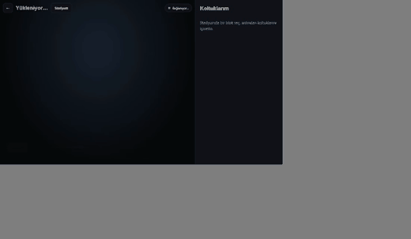

# Tüpraş Stadyumu · 3B Bilet

Stadyumu **kuş bakışından** gez, bir **blok** seç, **koltuğunu** işaretle; kamera kuş bakışından seçtiğin koltuğa uçsun ve **oturduğun yerden sahanın nasıl göründüğünü** göster.

> Portfolyo projesidir. Kulüp, lig veya stadyum işletmecisiyle bağlantısı yoktur. Maçlar, takımlar ve fiyatlar **kurgudur**; gerçek bilet satılmaz, ödeme alınmaz.



*Kuş bakışı → blok → iki koltuk seçimi → koltuktan görüş → çatıyı göster. Daha akıcı kayıt: [docs/demo.webm](docs/demo.webm) (10 MB, dosyaya tıklayınca GitHub oynatır). Kayıt, `frontend/scripts/record-demo.mjs` ile otomatik üretilir.*

## Ne yapıyor?

1. **Kuş bakışı:** 55 blok, iki kat (alt/üst), ~42.500 koltuk. Bloklar doluluğa ya da fiyat bölgesine göre renklenir; fareyle üzerine gelince bilgi çıkar.
2. **Blok:** Bloğa tıklayınca kamera sahadan o bloğa bakacak şekilde süzülür; koltuklar tek tek seçilebilir ("benim için seç" bitişik koltukları kendisi bulur).
3. **Koltuktan görüş:** Seçtiğin koltuğa tıkla, kamera kuş bakışından o koltuğun göz hizasına uçar. Sürükleyerek etrafa bakabilir, tekerlekle yakınlaşabilirsin. Birden fazla koltuğun arasında ileri/geri gidilir.
4. **Canlı:** Başka biri koltuk tuttuğunda ya da satın aldığında ekranında anında değişir (WebSocket). Tuttuğun koltuklar 5 dakika sana ayrılır.
5. **Bilet:** Ad/e-posta ile "satın al (demo)" → barkodlu bilet sayfası.

Fiyatlandırma, blok ve koltuk yerleşimi backend'den gelir; arayüz aynı geometriyi tek kaynaktan çizer.

## Mimari

```
backend/   Java 21 · Spring Boot · JPA · Flyway · WebSocket     (API + veritabanı)
frontend/  React 19 · TypeScript · Vite · three.js              (3B arayüz)
```

- **Katmanlı backend:** `domain → application → infrastructure / api`; bu kural ArchUnit testleriyle derleme sırasında denetlenir.
- **Çift satışa karşı koruma:** koltuk tutma koşullu `UPDATE` ile yapılır (iki kişi aynı anda tutmaya çalışırsa yalnızca biri kazanır); tutma kayıtları `SELECT … FOR UPDATE` ile kilitlenir. Tutma anahtarı veritabanında yalnızca SHA-256 özetiyle saklanır.
- **Stadyum düzeni tek yerde:** dış hat bir süper-elipstir (`|x/a|^n + |z/b|^n = 1`); blok sınırları yay uzunluğuyla tanımlanır. İstemci aynı formülü uygular ve Java'daki referans değerlerle birim testle karşılaştırılır.
- **3B sahne:** her blokun koltukları tek bir `InstancedMesh`; fare seçimi yalnızca blok levhaları ve odaklanılan bloğun koltukları üzerinde ışın atarak yapılır. Kamera geçişleri kavisli (Bézier) uçuşlardır.
- **Gerçek zamanlı:** koltuk değişiklikleri işlem tamamlandıktan sonra (`AFTER_COMMIT`) yayınlanır; istemci kopunca üstel geri çekilmeyle yeniden bağlanır ve kaçırdıklarını yeniden çeker.

## Çalıştırma

Gerekenler: **JDK 21**, **Node 20+**. Veritabanı kurulumu gerekmez (varsayılan bellek içi H2).

```powershell
cd backend
./mvnw -DskipTests package
java -jar target/stadyum-backend-1.0.0.jar        # http://localhost:8080
```

```powershell
cd frontend
npm install
npm run dev                                        # http://localhost:5173 (/api ve /ws backend'e yönlenir)
```

PostgreSQL için `.env.example` dosyasındaki `STADYUM_DB_*` değişkenlerini ortama ver. Gerçek değerler `.env` dosyasına yazılır ve git'e girmez. PostgreSQL ile çalıştırma yalnızca testlerde (gömülü PostgreSQL) denendi; elle kurulu bir PostgreSQL'e bağlanma bu sürümde denenmedi.

## Testler

```powershell
cd backend;  ./mvnw test                           # 65 test (birim + gömülü PostgreSQL ile entegrasyon + mimari kuralları)
cd frontend; npm test                              # geometri, koltuk indeksi, "benim için seç" mantığı
cd frontend; npx playwright test                   # uçtan uca: blok → koltuk → koltuktan görüş → bilet; çift tutma
```

Uçtan uca testler WebGL'i yazılım çizimiyle (SwiftShader) açar, ekran kartı gerekmez. Varsayılan tarayıcı sistemdeki Edge'dir; `PW_CHANNEL=chrome` ile değiştirilebilir.

## Dürüst sınırlar

- **Model yaklaşıktır.** Stadyum, internetten alınmış kuş bakışı ve iç mekân fotoğraflarına bakılarak elle kurulmuş bir modeldir; birebir mimari plan değildir. Çatı, cephe ve koltuk dokusu fotoğraflardaki genel görünümü (şeffaf beyaz yastıklı çatı, krem sütunlu cephe, siyah-beyaz koltuk deseni) taklit eder, ölçüler tahminidir.
- **Blok numaraları ve kapasite uydurmadır.** Gerçek blok adlandırması, koltuk sayıları ve kapasite ile birebir örtüşmez (modelde ~42.500 koltuk var).
- **Logo ve marka yok.** Kulüp, sponsor ya da lig logosu/yazısı kullanılmadı. Maç başlıkları kurgudur.
- **Koltuktan görüş gerçek fotoğraf değildir.** Gerçek zamanlı üretilen 3B görüntüdür; bazı 3B koltuk görüş araçları panoramik fotoğraf kullanır, bu proje kullanmaz.
- **Demo kalabalığı:** backend varsayılan olarak rastgele koltuk tutan/satan bir kalabalık simülasyonu çalıştırır (`STADYUM_CROWD=false` ile kapanır).
- **Ödeme yok.** "Satın al" yalnızca bilet kaydı üretir; kart bilgisi istenmez. Barkod görsel süstür, taranabilir bir standart değildir.
- **Docker dosyası yok.** Çalıştırma yolları yukarıdaki gibidir ve test edilmiştir; üretim dağıtımı (HTTPS, gerçek veritabanı, sınırlayıcılar) bu projede kurulmadı.
- **Veri bellektedir.** Backend kapanınca maçlar, tutmalar ve biletler silinir; açılışta örnek maçlar yeniden yüklenir.
- Üretim performansı yalnızca yazılım çizimiyle (SwiftShader) ve geliştirici makinesinde ölçüldü; ~1 milyon üçgenlik sahne zayıf ekran kartlarında yavaş olabilir.

## Dallar

`backend` (API ve veritabanı), `frontend` (3B arayüz), `main` (ikisinin birleşimi).
